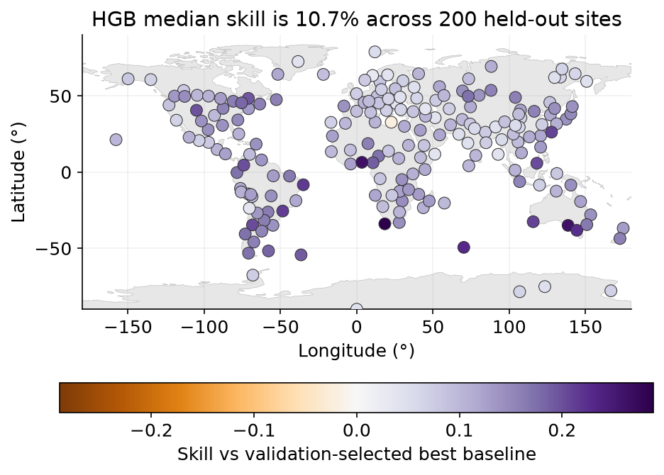
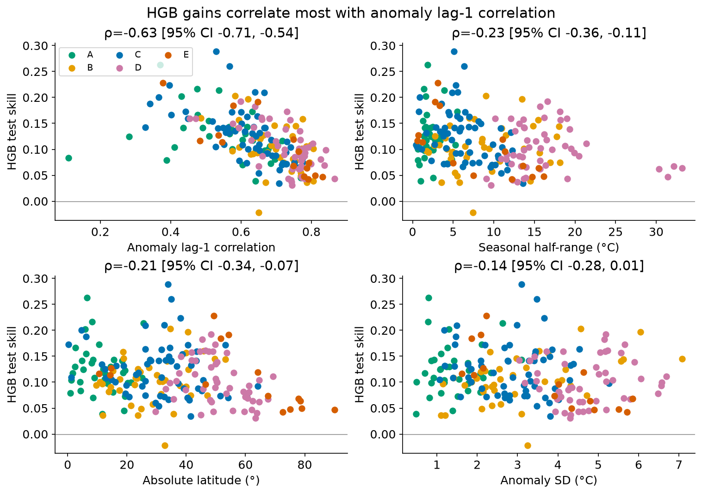
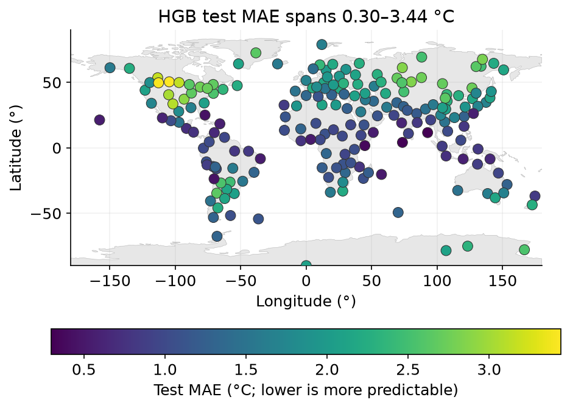
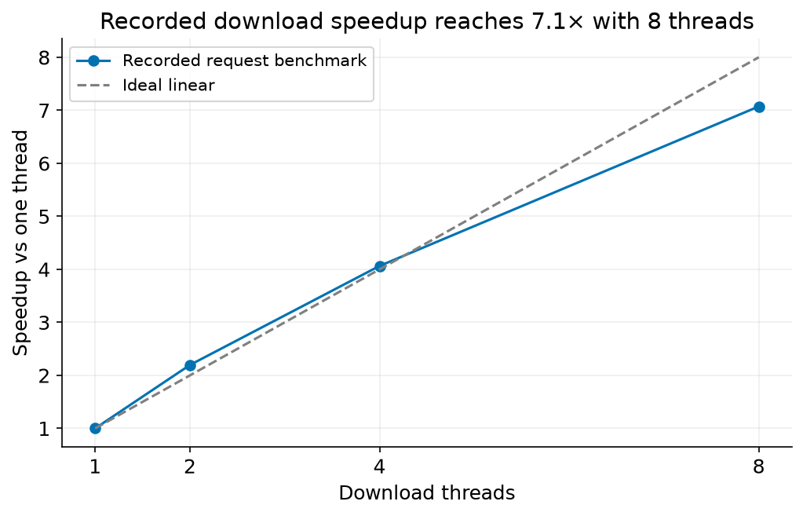

## Question

A small forecast error and a useful machine-learning model are different achievements. A tropical island can be easy to predict with a simple rule, while a continental site can remain difficult even after a model improves the forecast. I wanted to separate those questions and examine where additional model complexity earns its place.

I designed the comparison around next-day high temperature. The important decision was the baseline: forecasting tomorrow from today is often surprisingly competitive. A model should beat the stronger simple alternative before I describe its improvement as useful.

_Relative improvement is widespread in this sample, but the baseline keeps its size in perspective._

## Data

The sample contains 192 cities and 8 research stations, covering 29 Köppen classes. Sites were selected to represent climate classes and geographic spread, rather than world population or land area. Rare climates remain thinly represented; the study cannot claim that its average describes the whole globe.

Daily ERA5 reanalysis comes through Open-Meteo for 2015–2025, an 11-year period. The inputs include maximum and minimum temperature, humidity, pressure and wind. GeoNames supplies city information; Beck et al. (2023) supplies the Köppen–Geiger classification. Research-station coordinates supplement climates poorly represented by cities.

I credit [Open-Meteo](https://open-meteo.com/) and the underlying Copernicus/ECMWF ERA5 dataset, GeoNames and Beck et al.’s maps. These sources retain their licenses; the processed features, model results and interpretations are the project’s derived work. Natural Earth supplies the public-domain land outline in the static figures.

## Method

The split follows time: training uses 2015–2021, validation uses 2022–2023 and the held-out test uses 2024–2025. Hyperparameters and each site’s better baseline are selected on validation. Models are then refit on training plus validation and the test is touched once. Predictors for a target day use only earlier days and the target’s calendar information.

Persistence predicts tomorrow’s high from today’s high. Day-of-year climatology predicts the seasonal average and is fit on training years only during selection. I compared those rules with per-site ridge regression, per-site gradient boosting and a pooled gradient-boosting model. Preprocessing follows the training window rather than learning from future rows.

Skill is 1 − MAE_model / MAE_baseline, where MAE is mean absolute error. The reference is the better simple rule chosen on validation, not whichever looks easiest to beat on test. Paired moving-block bootstrap intervals resample model and baseline errors together in 14-day date blocks, preserving short-term dependence.

_Persistent anomalies leave less room to improve on a forecast that already carries today into tomorrow._

## Results

The headline is a median of site-level skills, not a reduction calculated from globally averaged errors. Per-site gradient boosting reduces MAE by a median 10.7% against the validation-selected better baseline across the sample in 2024–2025. At 191 of 200 sites, the 95% paired block-bootstrap interval is entirely above zero. This supports a broad but modest improvement within this evaluation.

Absolute error tells another story. In that same test period, model MAE ranges from 0.30 °C at Port Blair to 3.44 °C at Regina. The map of error therefore answers where this prediction task is difficult; the skill map answers how much the model adds beyond a simple rule.

_Forecast difficulty varies substantially even where the model improves on its baseline._

The strongest exploratory driver is training-year lag-1 autocorrelation of temperature anomalies, with Spearman ρ = −0.63 against test skill across sites. Where anomalies persist, persistence is already strong and ML helps least. That association is not a causal explanation, and the driver comparisons have no multiple-testing adjustment.

The downloader also needed to respect the source service. Its thread pool shares a weighted rate limiter, pauses globally on HTTP 429 and keeps a resumable ledger with cached chunks. A single benchmark of 48 fresh requests measured a 7.1× speedup at 8 threads versus 1 thread. That is a latency benchmark, not a claim that the complete rate-limited download became that much faster.

_Concurrency reduced latency in a single benchmark; the service’s daily limit still constrained the full download._

## Limitations

This is a retrospective study on reanalysis, not an operational forecast. ERA5’s gridded estimates smooth coastlines and terrain and do not represent a thermometer at each named city. Its delayed availability also means these inputs cannot simply become a live forecasting service.

The test covers only the stated held-out years. Bootstrap intervals are conditional on the selected models and do not include model-selection uncertainty. Climate-stratified sampling, limited rare-class coverage and daily rather than sub-daily inputs constrain generalization. The results do not establish an advantage over operational numerical weather prediction.

## What I did and what I'd do next

I chose the question, sources and evaluation design, directed and reviewed implementation by AI coding agents, verified results and wrote the findings. The baseline and timing rules were central decisions, not details left to implementation.

Next, I would test whether the relationships hold in another untouched period and investigate weak sites using richer weather inputs. Any operational version would need a separate evaluation using data actually available at forecast time.
