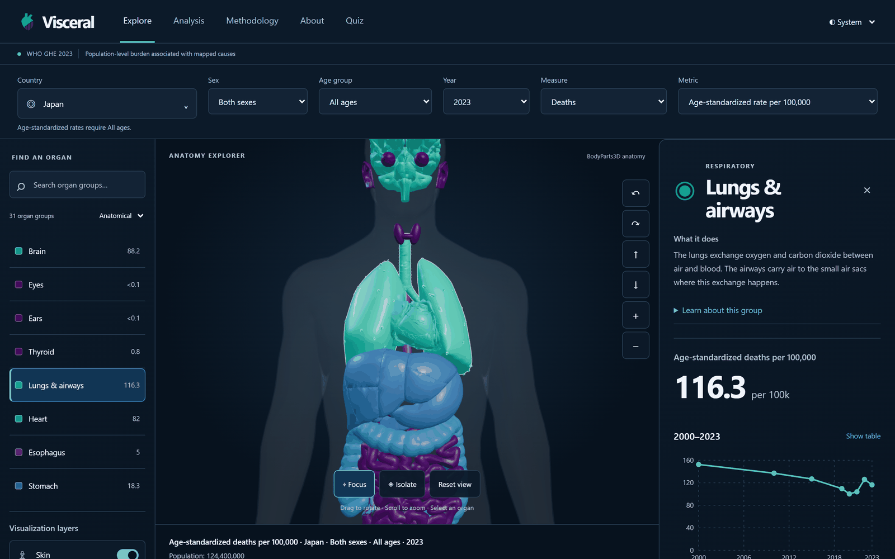
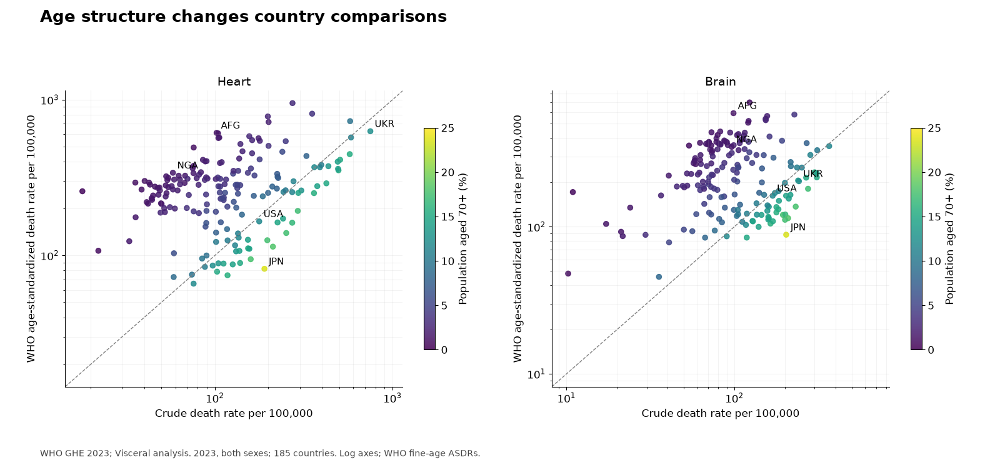
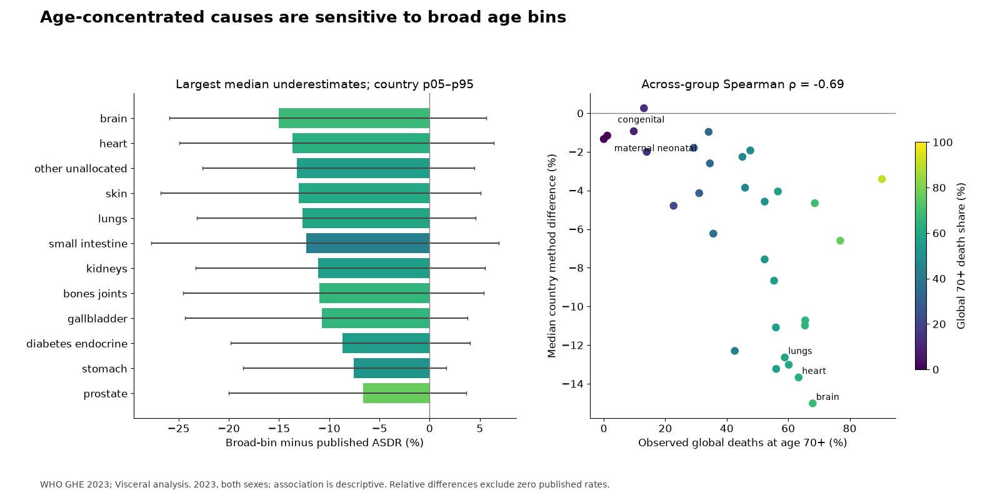

## Question

A country’s crude death rate mixes disease burden with the age structure of its population. I wanted to make that distinction visible: how much does a comparison change when everyone is evaluated against a common age distribution? I also wanted readers to see how sex, cause attribution and the choice of standard population affect the apparent distribution across the body.

I used anatomy as an entry point into the data. Selecting an organ should lead to its definition, rates and underlying causes, rather than imply that a coloured surface measures an individual’s health. The explorer links that visual view to filters, an HTML organ list and chart tables.

_Selecting lungs and airways connects the anatomy to a group definition and the filtered population’s rate and trend._

## Data

The source is WHO’s Global Health Estimates 2023. The pipeline contains 15,486,720 observations across countries, causes, measures, sex categories, age sheets and estimate years. These are tabulated estimates, not individual patient records. Deaths and disability-adjusted life years (DALYs) describe different aspects of burden.

The observed dates are 2000, 2010, 2015 and 2019–2023: eight estimate years, not an annual series spanning the whole period. I retain those gaps when interpreting change. For the project’s World aggregate, counts and populations are summed before rates are calculated; country rates are never averaged.

The cause-to-organ mapping is a project-derived interpretation, not an official WHO grouping. Primary nodes partition the cause hierarchy so that a parent and its children cannot be counted twice. Systemic and unallocated groups stay visible because underlying-cause attribution cannot neatly describe every affected tissue.

## Method

The pipeline parses WHO workbooks and validates tidy tables. It applies the cause mapping, standardizes and aggregates rates, then exports contract JSON for the web app. Reconciliation checks compare count-derived crude rates with published rates and retain known, pinned source inconsistencies explicitly. Missing values remain distinct from zero.

Country death comparisons sum WHO’s published fine-age cause-specific standardized rates. DALYs and the World aggregate instead use direct standardization over seven broad age bins. I kept that difference explicit rather than presenting the approximation as interchangeable with the published country rates.

The analysis compares crude and standardized rankings, observed-period changes and sensitivity to analytical choices. The web explorer provides a way to inspect those comparisons through country, sex, age, year and measure filters. Its keyboard-accessible organ list and tables give readers alternatives to interacting with the canvas.

_Countries’ age structures help explain why crude and standardized comparisons tell different stories._

## Results

Japan makes the issue concrete. For heart deaths in 2023, both sexes, its crude rate is 189.9 deaths per 100,000; its age-standardized rate is 81.99. Among 185 countries, with rank 1 meaning highest burden, those rates place Japan 43rd and 180th respectively. These exact values come from the project’s [exported ranking analysis](https://github.com/narowtow/visceral/blob/main/docs/analysis.md).

An older population makes Japan’s crude rate look high; adjusting for age moves it to near the lowest burden in this country comparison. That is a change of comparison method for the same year, not evidence that Japan’s health changed over time. Age adjustment and the observed age-specific burden both matter to the result.

Method sensitivity also changed the interpretation. In the 2023, both-sex country death comparisons, the broad-bin approximation’s median signed difference from the published fine-age sums is −15.02% for brain and −13.67% for heart. Those are method differences across countries, not uncertainty intervals on WHO’s estimates.

_Pooling ages changes standardized rates enough that the production country-death view uses WHO’s fine-age rates._

Holding the broad-bin method fixed, sensitivity analysis spans five standard populations. Using the WHO2026 standard population puts heart ahead of lungs in the global ordering of age-standardized death rates for 2023. Using the Segi standard population reverses that ordering. The body profile depends on declared weights as well as the underlying estimates.

## Limitations

WHO’s modeled point estimates do not establish causality, health-system performance or individual risk. Source uncertainty intervals are unavailable here. The organ aggregates and interpretations are the project’s own derived outputs; they are not official WHO figures or an endorsement.

Assigning one underlying cause to one primary group simplifies systemic disease and multimorbidity. The anatomical model also has limits: it is a male reference body, and changing the sex filter changes the statistics rather than the anatomy. Some structures are approximations. BodyParts3D, from the Database Center for Life Science, supplies the modified anatomy under CC BY 4.0; WHO’s data retain WHO’s terms.

## What I did and what I'd do next

I chose the questions, data sources and evaluation design. I directed and reviewed implementation by AI coding agents, verified the results and wrote up the findings. The project has 180+ automated test cases running in CI via GitHub Actions: 137 web and 50 pipeline test cases, verified by the owner on 2026-10-31.

Next, I would make the mapping rationale and method differences easier to inspect beside each comparison. I would prioritize that explanation before adding more visual complexity: readers need to know which choices can change the answer.
